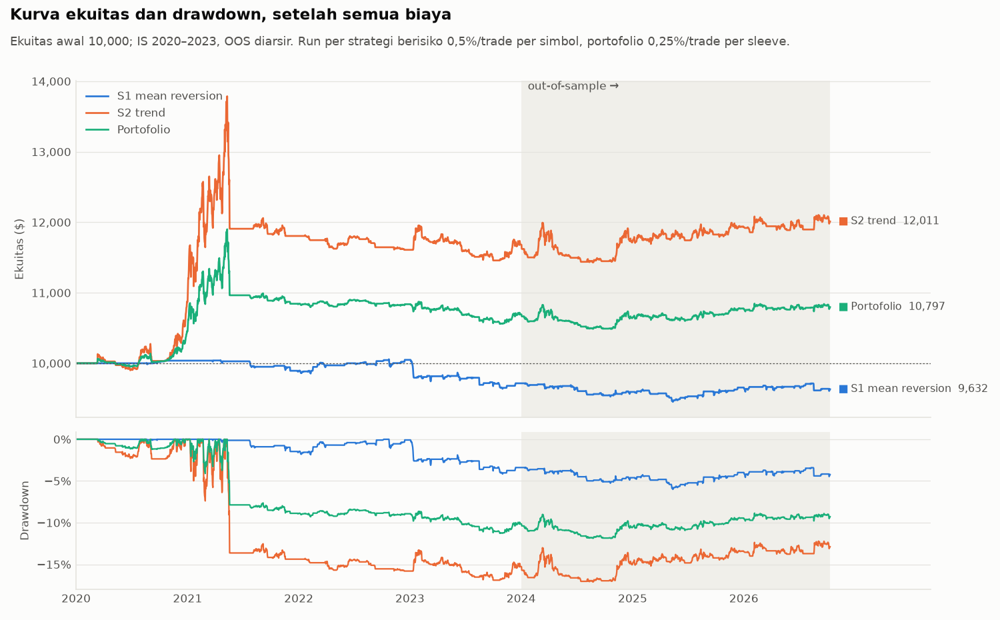
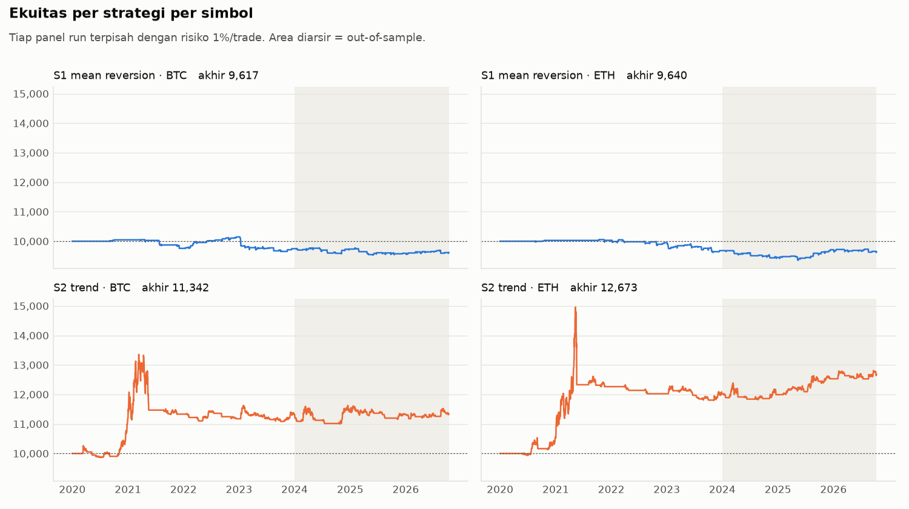
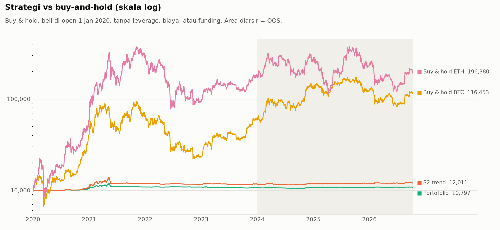
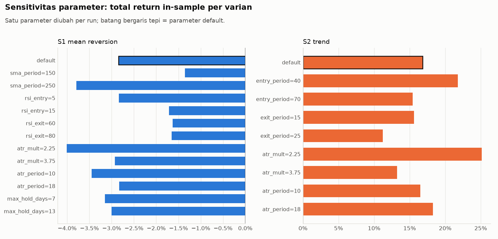
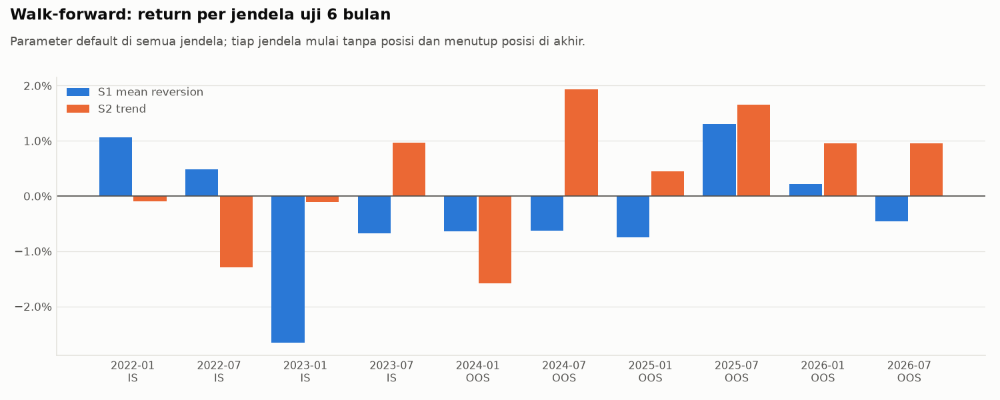

# Laporan Fase 1: Riset & Backtest Crypto Futures

Dibuat 2026-10-12 06:19 UTC dengan `python -m src.report`.
Out-of-sample dijalankan sekali pada 2026-10-12 06:11 UTC (hash config `7bf6e48972648fda`).
Data harian 2020-01-01 s/d 2026-10-11, sumber Binance USDⓈ-M (endpoint publik).

## Kesimpulan

**Tidak ada strategi yang lolos semua kriteria. Menurut PRD, fase 2 (paper trading) belum dimulai.**

| Strategi | Status | Kriteria yang gagal |
| --- | --- | --- |
| S1 mean reversion | **TIDAK LOLOS** | Profit factor OOS setelah biaya, Sensitivitas: tidak ada varian rugi (IS), Walk-forward: mayoritas jendela profit |
| S2 trend | **TIDAK LOLOS** | Jumlah trade IS + OOS |

| Strategi | Kriteria | Ambang | Hasil | Lolos |
| --- | --- | --- | --- | --- |
| S1 mean reversion | Profit factor OOS setelah biaya | > 1.2 | 0.88 | ❌ |
| S1 mean reversion | Max drawdown OOS | < 30% | 2.7% | ✅ |
| S1 mean reversion | Jumlah trade IS + OOS | >= 100 | 166 | ✅ |
| S1 mean reversion | Sensitivitas: tidak ada varian rugi (IS) | 0 varian rugi | 13/13 rugi: default, sma_period=150, sma_period=250, rsi_entry=5, rsi_entry=15, rsi_exit=60, rsi_exit=80, atr_mult=2.25, atr_mult=3.75, atr_period=10, atr_period=18, max_hold_days=7, max_hold_days=13 | ❌ |
| S1 mean reversion | Walk-forward: mayoritas jendela profit | > 50% | 4/10 (40%) | ❌ |
| S2 trend | Profit factor OOS setelah biaya | > 1.2 | 1.56 | ✅ |
| S2 trend | Max drawdown OOS | < 30% | 4.7% | ✅ |
| S2 trend | Jumlah trade IS + OOS | >= 100 | 60 | ❌ |
| S2 trend | Sensitivitas: tidak ada varian rugi (IS) | 0 varian rugi | 0/9 rugi | ✅ |
| S2 trend | Walk-forward: mayoritas jendela profit | > 50% | 6/10 (60%) | ✅ |

Kriteria dipakai persis seperti di PRD; tidak ada ambang yang diubah setelah melihat hasil.

## Catatan analis

**S1 (mean reversion RSI(2)) tidak punya edge setelah biaya di data ini.** Hasilnya rugi di
in-sample (PF 0,69), di out-of-sample (PF 0,88), dan di ke-13 varian parameter. Profilnya sesuai
hipotesis, sering menang kecil (winrate ~60%), tapi rata-rata kemenangannya (+0,25R) tidak
menutup rata-rata kerugiannya (−0,4 s/d −0,6R). Sisi short-nya rugi di kedua periode dan kedua
simbol. Kegagalan S1 tidak bergantung pada angka parameter.

**S2 (Donchian breakout) hanya gagal di jumlah trade (60 dari syarat 100).** Profit-nya bertahan di
out-of-sample (PF 1,56), semua varian sensitivitasnya profit, dan 6 dari 10 jendela walk-forward
profit. Tapi bukti edge-nya tipis:

- Hanya 60 trade dalam ~6,8 tahun. Dengan sampel sekecil itu, PF 1,56 masih bisa terjadi karena kebetulan.
- Di in-sample, satu trade BTC (Okt 2020–Mei 2021, +1.567) lebih besar dari total profit bersih S2-BTC.
- Di out-of-sample, PF S2-BTC hanya 1,03; hampir seluruh profit datang dari ETH.
- Sharpe S2 di bawah buy-and-hold di kedua periode (OOS 0,29 vs BTC 0,76 / ETH 0,39), meski
  drawdown-nya jauh lebih kecil.
- Funding memakan sebagian besar profit trend panjang (S2-BTC in-sample: funding 1.149 vs
  profit bersih 1.320), karena posisi long trend terbuka saat funding paling mahal.

**Diversifikasi bekerja secara statistik** (korelasi S1–S2 0,06 IS / 0,20 OOS), tapi tidak berguna
karena salah satu komponennya (S1) tidak punya edge.

**Return absolut kecil karena desainnya.** Risiko 1% per trade dengan stop 3×ATR menghasilkan
notional rata-rata sekitar 0,1x ekuitas. Return dan drawdown kira-kira berbanding lurus dengan
risiko per trade, jadi menaikkan risiko tidak mengubah profit factor maupun Sharpe.

**Langkah yang masuk akal berikutnya** (semuanya keputusan kamu, bukan rekomendasi untuk
meloloskan strategi):

1. Terima hasil ini apa adanya dan jangan lanjut ke fase 2.
2. Tinjau ulang kriteria ≥100 trade untuk strategi trend harian. Keputusan itu harus dicatat
   sebagai perubahan **setelah** melihat OOS, dan S2 sebaiknya diuji di data yang belum
   tersentuh, misalnya beberapa bulan paper trading atau simbol lain, sebelum dianggap lolos.
3. Uji hipotesis baru (simbol lain, varian strategi) sebagai riset baru dengan pembagian data
   baru. Data OOS 2024–2026 sudah terpakai dan tidak lagi murni untuk menguji ide yang lahir
   dari laporan ini.

## Kurva ekuitas dan drawdown

## Metrik out-of-sample (2024-01-01 s/d 2026-10-11)

Kolom `s1:BTC` dll. adalah run tunggal (risiko 1%/trade); `s1`/`s2` = strategi di dua simbol
(0,5%/trade per sleeve); `portfolio` = empat sleeve (0,25%/trade per sleeve).

| Metrik | s1:BTC | s1:ETH | s2:BTC | s2:ETH | s1 | s2 | portfolio | buyhold:BTC | buyhold:ETH |
| --- | ---: | ---: | ---: | ---: | ---: | ---: | ---: | ---: | ---: |
| Total return | -1.3% | -0.4% | 0.2% | 5.5% | -0.9% | 2.8% | 1.0% | 97.9% | 11.0% |
| CAGR | -0.5% | -0.2% | 0.1% | 1.9% | -0.3% | 1.0% | 0.4% | 27.8% | 3.8% |
| Max drawdown | 2.5% | 3.4% | 5.1% | 4.6% | 2.7% | 4.7% | 3.1% | 53.0% | 67.6% |
| Durasi drawdown terlama (hari) | 615 | 688 | 663 | 514 | 999 | 695 | 695 | 370 | 515 |
| Calmar | -0.19 | -0.05 | 0.01 | 0.42 | -0.11 | 0.21 | 0.11 | 0.53 | 0.06 |
| Sharpe (harian, ×√365) | -0.25 | -0.07 | 0.04 | 0.50 | -0.19 | 0.29 | 0.17 | 0.76 | 0.39 |
| Pertama kali drawdown ≥ 20% | - | - | - | - | - | - | - | 2024-05-01 | 2024-03-19 |
| Pertama kali drawdown ≥ 30% | - | - | - | - | - | - | - | 2025-11-20 | 2024-08-04 |
| Persentase waktu terbuka | 19.1% | 18.8% | 57.4% | 61.3% | 28.3% | 76.4% | 83.8% | - | - |
| Jumlah trade | 40 | 44 | 17 | 13 | 84 | 30 | 114 | - | - |
| Winrate | 57.5% | 61.4% | 41.2% | 61.5% | 59.5% | 50.0% | 57.0% | - | - |
| Profit factor | 0.80 | 0.94 | 1.03 | 2.97 | 0.88 | 1.56 | 1.16 | - | - |
| Expectancy (R) | -0.03 | -0.01 | 0.02 | 0.42 | -0.02 | 0.19 | 0.04 | - | - |
| Rata-rata win ($) | 22.92 | 26.44 | 106.93 | 102.92 | 12.42 | 52.55 | 10.85 | - | - |
| Rata-rata loss ($) | -38.82 | -44.53 | -73.00 | -55.38 | -20.80 | -33.71 | -12.39 | - | - |
| Rata-rata win (R) | 0.23 | 0.27 | 1.09 | 1.02 | 0.25 | 1.05 | 0.44 | - | - |
| Rata-rata loss (R) | -0.39 | -0.45 | -0.73 | -0.55 | -0.42 | -0.67 | -0.50 | - | - |
| Rata-rata lama posisi (hari) | 4.97 | 4.48 | 34.65 | 48.00 | 4.71 | 40.43 | 14.11 | - | - |
| Total fee ($) | 39.54 | 30.22 | 17.59 | 9.43 | 34.88 | 13.59 | 24.34 | - | - |
| Total funding ($, + = dibayar) | 18.28 | 1.91 | 133.74 | 105.29 | 10.06 | 119.74 | 64.99 | - | - |
| Total slippage ($) | 39.54 | 30.22 | 17.59 | 9.43 | 34.88 | 13.59 | 24.34 | - | - |
| Losing streak terpanjang | 4 | 3 | 2 | 2 | 4 | 3 | 5 | - | - |
| Trade long | 24 | 20 | 11 | 8 | 44 | 19 | 63 | - | - |
| Trade short | 16 | 24 | 6 | 5 | 40 | 11 | 51 | - | - |
| PnL long ($) | -44.10 | 75.72 | 57.74 | 280.46 | 16.78 | 168.21 | 93.62 | - | - |
| PnL short ($) | -88.66 | -118.67 | -39.20 | 266.05 | -103.24 | 114.39 | 4.33 | - | - |
| Hari sinyal ditolak (cek likuidasi) | 0 | 1 | 0 | 0 | 1 | 0 | 1 | - | - |

## Metrik in-sample (2020-01-01 s/d 2023-12-31)

| Metrik | s1:BTC | s1:ETH | s2:BTC | s2:ETH | s1 | s2 | portfolio | buyhold:BTC | buyhold:ETH |
| --- | ---: | ---: | ---: | ---: | ---: | ---: | ---: | ---: | ---: |
| Total return | -2.5% | -3.2% | 13.2% | 20.2% | -2.8% | 16.8% | 6.9% | 488.6% | 1668.8% |
| CAGR | -0.6% | -0.8% | 3.1% | 4.7% | -0.7% | 4.0% | 1.7% | 55.7% | 105.0% |
| Max drawdown | 4.9% | 4.3% | 17.0% | 21.1% | 4.2% | 16.9% | 11.3% | 76.7% | 79.4% |
| Durasi drawdown terlama (hari) | 510 | 809 | 1,023 | 964 | 534 | 964 | 964 | 783 | 783 |
| Calmar | -0.13 | -0.19 | 0.19 | 0.22 | -0.17 | 0.23 | 0.15 | 0.73 | 1.32 |
| Sharpe (harian, ×√365) | -0.35 | -0.53 | 0.38 | 0.49 | -0.50 | 0.48 | 0.36 | 1.00 | 1.26 |
| Pertama kali drawdown ≥ 20% | - | - | - | 2023-07-14 | - | - | - | 2020-03-08 | 2020-02-26 |
| Pertama kali drawdown ≥ 30% | - | - | - | - | - | - | - | 2020-03-12 | 2020-03-08 |
| Persentase waktu terbuka | 14.2% | 10.9% | 57.3% | 44.6% | 19.3% | 61.5% | 70.6% | - | - |
| Jumlah trade | 47 | 35 | 18 | 12 | 82 | 30 | 112 | - | - |
| Winrate | 57.4% | 62.9% | 27.8% | 33.3% | 59.8% | 30.0% | 51.8% | - | - |
| Profit factor | 0.75 | 0.61 | 2.28 | 4.24 | 0.69 | 3.02 | 1.78 | - | - |
| Expectancy (R) | -0.05 | -0.09 | 0.76 | 1.70 | -0.07 | 1.14 | 0.25 | - | - |
| Rata-rata win ($) | 28.68 | 22.58 | 469.85 | 659.56 | 12.99 | 279.17 | 27.23 | - | - |
| Rata-rata loss ($) | -51.38 | -62.67 | -79.11 | -77.70 | -27.90 | -39.59 | -16.43 | - | - |
| Rata-rata win (R) | 0.29 | 0.23 | 4.58 | 6.39 | 0.26 | 5.38 | 1.06 | - | - |
| Rata-rata loss (R) | -0.52 | -0.63 | -0.71 | -0.64 | -0.56 | -0.69 | -0.61 | - | - |
| Rata-rata lama posisi (hari) | 4.57 | 4.71 | 46.89 | 54.67 | 4.63 | 50.00 | 16.79 | - | - |
| Total fee ($) | 39.75 | 27.05 | 17.50 | 12.74 | 33.38 | 15.23 | 25.28 | - | - |
| Total funding ($, + = dibayar) | 3.97 | 0.70 | 1,148.71 | 1,002.87 | 2.34 | 1,082.08 | 536.78 | - | - |
| Total slippage ($) | 39.75 | 27.05 | 17.50 | 12.74 | 33.38 | 15.23 | 25.28 | - | - |
| Losing streak terpanjang | 6 | 2 | 5 | 4 | 5 | 9 | 5 | - | - |
| Trade long | 20 | 19 | 11 | 10 | 39 | 21 | 60 | - | - |
| Trade short | 27 | 16 | 7 | 2 | 43 | 9 | 52 | - | - |
| PnL long ($) | -159.03 | -15.22 | 1,419.77 | 2,177.05 | -86.93 | 1,809.60 | 856.50 | - | - |
| PnL short ($) | -94.19 | -302.75 | -98.91 | -160.43 | -197.34 | -128.50 | -164.61 | - | - |
| Hari sinyal ditolak (cek likuidasi) | 18 | 31 | 3 | 15 | 49 | 18 | 67 | - | - |

**Korelasi PnL harian S1 vs S2:** in-sample 0.056, out-of-sample 0.199.

## Sensitivitas parameter (in-sample saja)

| Strategi | Varian | Return | Profit factor | Max DD | Trade | Return BTC | Return ETH |
| --- | --- | ---: | ---: | ---: | ---: | ---: | ---: |
| S1 mean reversion | default | -2.8% | 0.69 | 4.2% | 82 | -2.5% | -3.2% |
| S1 mean reversion | sma_period=150 | -1.4% | 0.84 | 3.0% | 84 | -0.6% | -2.2% |
| S1 mean reversion | sma_period=250 | -3.8% | 0.61 | 4.8% | 79 | -3.6% | -4.0% |
| S1 mean reversion | rsi_entry=5 | -2.8% | 0.48 | 3.2% | 40 | -1.9% | -3.7% |
| S1 mean reversion | rsi_entry=15 | -1.7% | 0.84 | 4.4% | 119 | -2.7% | -0.8% |
| S1 mean reversion | rsi_exit=60 | -1.6% | 0.80 | 3.4% | 87 | -0.8% | -2.5% |
| S1 mean reversion | rsi_exit=80 | -1.7% | 0.84 | 3.7% | 80 | -3.2% | -0.1% |
| S1 mean reversion | atr_mult=2.25 | -4.0% | 0.74 | 5.9% | 103 | -3.1% | -5.0% |
| S1 mean reversion | atr_mult=3.75 | -2.9% | 0.54 | 3.8% | 59 | -1.5% | -4.3% |
| S1 mean reversion | atr_period=10 | -3.5% | 0.64 | 4.9% | 83 | -2.1% | -4.8% |
| S1 mean reversion | atr_period=18 | -2.8% | 0.69 | 4.1% | 83 | -2.5% | -3.2% |
| S1 mean reversion | max_hold_days=7 | -3.2% | 0.67 | 4.2% | 84 | -3.1% | -3.3% |
| S1 mean reversion | max_hold_days=13 | -3.0% | 0.68 | 4.1% | 82 | -2.1% | -3.9% |
| S2 trend | default | 16.8% | 3.02 | 16.9% | 30 | 13.2% | 20.2% |
| S2 trend | entry_period=40 | 21.8% | 2.82 | 18.1% | 38 | 19.9% | 23.5% |
| S2 trend | entry_period=70 | 15.4% | 3.30 | 16.9% | 23 | 11.4% | 19.2% |
| S2 trend | exit_period=15 | 15.6% | 2.71 | 10.4% | 33 | 21.6% | 9.4% |
| S2 trend | exit_period=25 | 11.2% | 2.38 | 20.8% | 29 | 12.3% | 10.0% |
| S2 trend | atr_mult=2.25 | 25.1% | 3.27 | 17.9% | 36 | 20.1% | 29.6% |
| S2 trend | atr_mult=3.75 | 13.3% | 2.99 | 14.3% | 27 | 11.1% | 15.2% |
| S2 trend | atr_period=10 | 16.5% | 3.11 | 15.7% | 30 | 12.7% | 20.1% |
| S2 trend | atr_period=18 | 18.3% | 3.17 | 16.4% | 31 | 13.7% | 22.7% |

## Walk-forward

Jendela uji 6 bulan, bergeser tiap 6 bulan, mulai setelah 2 tahun data. Parameter tidak disetel
(PRD melarang optimasi), jadi jendela latih hanya menentukan kapan uji pertama dimulai.

| Jendela uji | Segmen | S1 | S2 | Portofolio |
| --- | --- | ---: | ---: | ---: |
| 2022-01-01 s/d 2022-06-30 | IS | 1.1% | -0.1% | 0.5% |
| 2022-07-01 s/d 2022-12-31 | IS | 0.5% | -1.3% | -0.4% |
| 2023-01-01 s/d 2023-06-30 | IS | -2.7% | -0.1% | -1.4% |
| 2023-07-01 s/d 2023-12-31 | IS | -0.7% | 1.0% | 0.1% |
| 2024-01-01 s/d 2024-06-30 | OOS | -0.6% | -1.6% | -1.1% |
| 2024-07-01 s/d 2024-12-31 | OOS | -0.6% | 1.9% | 0.6% |
| 2025-01-01 s/d 2025-06-30 | OOS | -0.7% | 0.4% | -0.2% |
| 2025-07-01 s/d 2025-12-31 | OOS | 1.3% | 1.7% | 1.5% |
| 2026-01-01 s/d 2026-06-30 | OOS | 0.2% | 1.0% | 0.6% |
| 2026-07-01 s/d 2026-10-11 (parsial) | OOS | -0.5% | 1.0% | 0.2% |

## Monte Carlo: urutan trade diacak 1.000 kali (IS + OOS)

| Max drawdown | S1 mean reversion | S2 trend | Portofolio |
| --- | ---: | ---: | ---: |
| Urutan asli | 5.8% | 3.9% | 4.3% |
| Median | 5.0% | 3.0% | 2.5% |
| Persentil 95 | 6.5% | 4.8% | 4.0% |
| Persentil 99 | 7.2% | 5.7% | 4.6% |
| Terburuk | 7.9% | 7.1% | 6.1% |

Angka ini **meremehkan** drawdown sebenarnya: simulasi hanya memakai trade yang sudah ditutup
dan mengabaikan profit belum terealisasi yang hilang di tengah trade serta posisi yang
tumpang-tindih. Contohnya, max drawdown S2 di in-sample sebenarnya
16.9%. Untuk aturan kill switch, pakai drawdown
dari kurva ekuitas, bukan dari tabel ini.

## Drawdown 20% / 30% (bahan kill switch fase 2)

| Run | Pertama DD ≥ 20% (IS) | Pertama DD ≥ 30% (IS) | Pertama DD ≥ 20% (OOS) | Pertama DD ≥ 30% (OOS) |
| --- | ---: | ---: | ---: | ---: |
| s1:BTC | - | - | - | - |
| s1:ETH | - | - | - | - |
| s2:BTC | - | - | - | - |
| s2:ETH | 2023-07-14 | - | - | - |
| s1 | - | - | - | - |
| s2 | - | - | - | - |
| portfolio | - | - | - | - |
| buyhold:BTC | 2020-03-08 | 2020-03-12 | 2024-05-01 | 2025-11-20 |
| buyhold:ETH | 2020-02-26 | 2020-03-08 | 2024-03-19 | 2024-08-04 |

## Setup dan asumsi

| Item | Nilai |
| --- | --- |
| Simbol | BTC/USDT:USDT, ETH/USDT:USDT |
| Eksekusi | sinyal di close hari t, eksekusi di open t+1 |
| Fee taker | 0.05% per sisi |
| Slippage | 0.05% per sisi, termasuk fill stop |
| Funding | riwayat aktual Binance × qty × open bar tempat event jatuh |
| Risiko per trade | 1% ekuitas, dibagi rata antar sleeve dalam satu run |
| Batas leverage | 2x per posisi, total notional 3x ekuitas |
| Cek likuidasi | isolated 3x, MMR 0.5%, jarak likuidasi ≥ 1.5 × jarak stop |
| Ekuitas awal | 10,000 |

**Keputusan desain yang diambil selama fase 1** (dikonfirmasi lewat chat kecuali disebut lain):

1. Cek likuidasi memakai leverage isolated tetap 3x dengan buffer 1,5×. Akibatnya stop yang lebih
   jauh dari ~21,9% dari harga entry ditolak. Ini sering terjadi di ETH 2021–2022. Alternatif
   (leverage dipilih per trade) diusulkan tapi tidak diadopsi.
2. Risiko portofolio dibagi rata dari satu ekuitas bersama (1% ÷ jumlah sleeve).
3. Sinyal berlawanan: posisi ditutup di open t+1, posisi baru dibuka di open t+2 tanpa cek ulang.
4. Sisi short S1 aktif (pertanyaan terbuka di PRD, tidak diubah).
5. Asumsi konservatif dari engine, tidak ditanyakan karena PRD meminta versi yang lebih merugikan:
   slippage juga kena di fill stop; stop menang atas exit sinyal di bar yang sama; di bar saat
   stop kena hanya funding yang dibayar yang dihitung, funding yang diterima tidak.
6. Walk-forward tanpa penyetelan parameter (lihat bagian Walk-forward).
7. Indikator memakai smoothing Wilder; data mulai 1 Jan 2020, sehingga S1 (SMA 200) baru bisa
   trading sekitar Juli 2020.

## Pertanyaan terbuka dari PRD

- [ ] Exchange untuk fase 2 dan status izinnya di Indonesia (cek ke OJK).
- [ ] Tarif fee aktual akun, untuk menggantikan 0,05%.
- [ ] Tambah simbol lain (mis. SOL)?
- [ ] Sisi short S1: di data ini rugi di IS dan OOS untuk kedua simbol.
- [ ] Kriteria lolos: perlu ditinjau, terutama syarat ≥100 trade untuk strategi trend harian.
